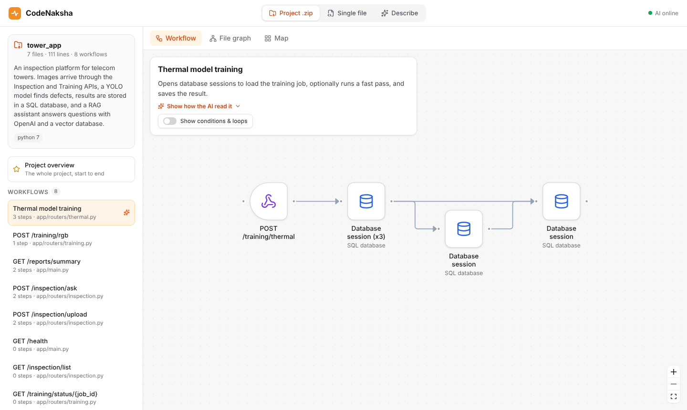

<div align="center">

# CodeNaksha

**See how any codebase works: as a workflow, a file graph and a map.**

Upload a project, drop a single file in any language, or describe a process in plain words.
CodeNaksha turns it into clear, n8n-style workflows with a short AI summary, running fully on your own hardware.

[](LICENSE)
[](https://github.com/<your-username>/codenaksha/actions/workflows/ci.yml)


</div>

---

## Contents

- [Features](#features)
- [Screenshots](#screenshots)
- [How it works](#how-it-works)
- [Requirements](#requirements)
- [Quick start (Docker)](#quick-start-docker)
- [Local development](#local-development)
- [Configuration](#configuration)
- [Deployment](#deployment)
- [Security](#security)
- [API](#api)
- [Project structure](#project-structure)
- [Troubleshooting](#troubleshooting)
- [Training your own model](#training-your-own-model)
- [Roadmap](#roadmap)
- [Contributing](#contributing)
- [License](#license)

---

## Features

Pick a mode at the top of the screen:

| Mode | You give | You get |
|---|---|---|
| **Project .zip** | a zip of your repository | the **full project workflow** with an AI summary, every API route, job and CLI traced step by step, a file graph and a map |
| **Single file** | one source file in **any language** | a workflow of that file with a short AI summary, each step linked to its line |
| **Describe** | a process in plain words | a workflow or flowchart with decisions, agents and services |

**For a project zip:**

- **Project overview** (opens first). Entry points grouped by feature ("Training API", "Inspection API", "Command line", "Start main.tsx") → your code → the services it uses (databases, AI models, vector stores, cloud, payments). It appears seconds after the zip is read; the AI summary fills in while you look.
- **Workflows.** Each entry point traced step by step, including AI agents and their tools, decisions, error paths, loops and parallel steps. Click **Explain with AI** for plain-English step names.
- **File graph.** Every file and what it imports. Click a file to see its role, functions and connections.
- **Map.** A treemap of the whole repository: folders as regions, files sized by lines of code.

**Built for real projects:**

- **Fast.** Code analysis takes seconds. Up front, the model writes only the overview and a few batched file summaries; workflows are explained on demand, and every answer is cached.
- **Readable.** The simple view hides decisions and loops (one switch shows them), and repeated calls are merged: `Database session (x4)`.
- **Private.** Everything runs locally with an open model. Code is parsed, never executed, and deleted right after analysis.
- **Works without AI.** With the model offline, you still get every workflow, the file graph and the map, with names taken from the code.

---

## Screenshots

| One workflow, explained by AI | Single file (any language) |
|---|---|
|  |  |

| File graph | Map |
|---|---|
|  |  |

*Screenshots use a small sample project.*

---

## How it works

Most of the work is plain, deterministic code. The AI model only adds explanations, so a mid-range GPU (or even a CPU) is enough.

```
 .zip ─► safe unzip ─► tree-sitter parse (all CPU cores) ─► resolve imports ─► file graph + map
                                    │
                                    ├─► detect entry points (routes, jobs, CLIs, events)
                                    ├─► detect services (Postgres, OpenAI, Qdrant, S3, ...)
                                    ├─► trace control flow ─► workflows (repeats merged)
                                    └─► project overview: entries → code → services
                                                                      │
                Qwen3-Coder via llama.cpp (optional) ◄── compact JSON ┘
                  • overview: title, summary, role of each part (1 request)
                  • summaries of the most-used files (batched, cached by file hash)
                  • step names for a workflow: only when you click "Explain with AI"
                  • JSON-schema constrained output, validated in code
```

**Deep thinking without a thinking mode.** Every response schema starts with an `analysis` field, so the model reasons first and answers second. Graph problems are found by a validator in plain code (`backend/app/llm/validate.py`), and only those errors go back to the model.

**Single file, any language.** The file is sent to the model with line numbers; Python, JavaScript and TypeScript files also get a function outline from the parser. The model returns a checked workflow plus a summary.

### What a workflow shows

| In the code | In the workflow |
|---|---|
| a function that uses a service (DB, Slack, Stripe, ...) | a step with the service's icon |
| an LLM call with helper functions | an **agent** with its **tools** underneath |
| `if` / `elif` / `else`, `match`, `switch` | a **decision** with Yes / No paths |
| `try` / `except`, `try` / `catch` | a red **error** path from the step that can fail |
| `for`, `while`, `items.forEach(...)` | a **loop** with a back-edge |
| `raise`, `throw`, early `return` | an **end** node ("Error 404", "Return early") |
| `asyncio.gather`, `Promise.all` | steps that run **in parallel** |
| the same call several times in a row | one step: `Database session (x4)` |

### Supported languages

| Language | File graph & map | Workflows |
|---|---|---|
| Python | ✅ | ✅ FastAPI (incl. `APIRouter(prefix=...)`), Flask, Celery, Click/Typer, AWS Lambda, `__main__` |
| JavaScript / TypeScript | ✅ | ✅ Express-style routers, NestJS, cron, Bull/BullMQ, Lambda |
| Go, Java, C#, PHP, Ruby, Rust, C/C++, ... | Listed in the map | Use **Single file** mode (AI-based, any language) |

---

## Requirements

### Hardware

Qwen3-Coder-30B-A3B is a **Mixture-of-Experts** model: 30B parameters in total, but only about 3B are active per token. llama.cpp keeps part of the expert weights in system RAM (`--n-cpu-moe`), so the model doesn't need to fit in VRAM.

| Setup | Minimum | Example GPUs |
|---|---|---|
| **GPU + CPU** (recommended) | NVIDIA GPU with 8 GB+ VRAM, **32 GB RAM** | RTX 3050 8 GB, RTX 3060, RTX 4060 and up |
| **Entry-level GPU** | NVIDIA GPU with 4–6 GB VRAM, **32 GB RAM** | RTX 3050 laptop (4 / 6 GB), GTX 1660. Works with the experts in RAM; slower |
| **CPU only** | **32 GB RAM**, modern 8-core CPU | No GPU needed. Slower; fast RAM helps most |
| **No model** | Any machine | Code analysis only |

**Yes, it runs on an RTX 3050.** Because only about 3B parameters are active per token and the experts can live in system RAM, the GPU mainly holds attention and the context. See [Running on an RTX 3050](#running-on-an-rtx-3050-or-other-entry-level-gpus) for ready-to-use settings.

The default model file (`Q4_K_M` GGUF) is about **18.6 GB** on disk and is downloaded on first start.

### Software

- **Docker Engine** with Docker Compose v2
- For GPU: an NVIDIA driver and the **NVIDIA Container Toolkit** (see [GPU setup](#gpu-setup-once))
- For local development: **Python 3.10+** and **Node 20+**

---

## Quick start (Docker)

```bash
git clone https://github.com/<your-username>/codenaksha.git
cd codenaksha
cp .env.example .env
```

Set `LLM_API_KEY` in `.env` to a long random string:

```bash
python3 -c "import secrets; print(secrets.token_urlsafe(32))"
```

Then pick one:

```bash
# A) NVIDIA GPU + system RAM (recommended)
docker compose --profile gpu up -d --build

# B) CPU only. First set LLM_BASE_URL=http://llm-cpu:8080/v1 in .env
docker compose --profile cpu up -d --build

# C) No AI model: code analysis only
docker compose up -d --build
```

Open **http://localhost:8080**.

The first start downloads the model (about 18.6 GB). Follow it with:

```bash
docker compose logs -f llm-gpu      # or llm-cpu
```

It's ready when the log shows the server listening on port 8080, and the status in the top-right corner of the UI shows **AI online**.

### GPU setup (once)

Docker needs the **NVIDIA Container Toolkit** to use your GPU. Without it you get `could not select device driver "nvidia"`.

```bash
nvidia-smi                                   # the driver must work on the machine first

curl -fsSL https://nvidia.github.io/libnvidia-container/gpgkey \
  | sudo gpg --dearmor -o /usr/share/keyrings/nvidia-container-toolkit-keyring.gpg
curl -s -L https://nvidia.github.io/libnvidia-container/stable/deb/nvidia-container-toolkit.list \
  | sed 's#deb https://#deb [signed-by=/usr/share/keyrings/nvidia-container-toolkit-keyring.gpg] https://#g' \
  | sudo tee /etc/apt/sources.list.d/nvidia-container-toolkit.list
sudo apt-get update && sudo apt-get install -y nvidia-container-toolkit
sudo nvidia-ctk runtime configure --runtime=docker
sudo systemctl restart docker

docker run --rm --gpus all ubuntu nvidia-smi # must list your GPU
```

Use **Docker Engine** (`docker context show` prints `default`). Docker Desktop on Linux and the snap package can't pass a GPU to containers.

### Tuning for your GPU

| Setting | Default | What it does |
|---|---|---|
| `LLM_CPU_MOE` | `30` | Layers (of 48) whose experts stay in system RAM. **Lower = faster, more VRAM.** |
| `LLM_CTX_SIZE` | `32768` | Total context, shared by all parallel slots |
| `LLM_PARALLEL` | `2` | Requests the model handles at once (match `LLM_CONCURRENCY`) |
| `LLM_GGUF_REPO` | `unsloth/Qwen3-Coder-30B-A3B-Instruct-GGUF:Q4_K_M` | Model file. Use `:Q3_K_M` if RAM is tight. |
| `LLAMA_IMAGE_TAG` | `server-cuda` | Use `server-cuda13` with NVIDIA driver 590+ |

Starting values for `LLM_CPU_MOE`: **4–6 GB VRAM → 48 (all experts in RAM) · 8 GB → 40 · 12 GB → 30 · 16 GB → 20 · 24 GB → 0–8.**
Watch `nvidia-smi`: if VRAM stays below about 80%, lower the value; if the model crashes with out-of-memory, raise it. After a change, run `docker compose --profile gpu up -d` again.

### Running on an RTX 3050 (or other entry-level GPUs)

Use the same model; just keep more of it in system RAM and serve one request at a time. Put these in `.env` (and `LLM_CONCURRENCY=1` in `backend/.env` for local development):

| | RTX 3050 desktop (8 GB) | RTX 3050 laptop (4–6 GB) |
|---|---|---|
| `LLM_CPU_MOE` | `40` | `48` |
| `LLM_CTX_SIZE` | `16384` | `16384` (use `8192` on 4 GB if it runs out of memory) |
| `LLM_PARALLEL` | `1` | `1` |
| `LLM_CONCURRENCY` | `1` | `1` |
| `MAX_FILE_SUMMARIES` | `20` | `20` |
| `LLM_TIMEOUT_S` | `300` | `600` |

Then restart the model: `docker compose --profile gpu up -d llm-gpu`.

These are starting values: watch `nvidia-smi` and lower `LLM_CPU_MOE` while VRAM stays below about 80%. You still need **32 GB of system RAM**; with 16–24 GB, use `LLM_GGUF_REPO=unsloth/Qwen3-Coder-30B-A3B-Instruct-GGUF:Q3_K_M`. Expect slower answers than on bigger cards. The code analysis itself is just as fast, and it appears first anyway.

---

## Local development

The **model runs in Docker**; the backend and frontend run directly on your machine.

**1. Start only the model.** It listens on `127.0.0.1:8081`, reachable from this machine only:

```bash
docker compose --profile gpu up -d llm-gpu
```

**2. Create `backend/.env`.** The backend reads the `.env` in the folder you start it from, not the project root. Docker service names like `llm-gpu` don't resolve outside Docker, so use `localhost`:

```env
LLM_ENABLED=true
LLM_BASE_URL=http://localhost:8081/v1
LLM_MODEL=flowlens-llm
LLM_API_KEY=<same value as LLM_API_KEY in the root .env>
LLM_TIMEOUT_S=300
LLM_CONCURRENCY=2
MAX_CONCURRENT_JOBS=1
RATE_LIMIT_PER_HOUR=0
DATA_DIR=./data
```

**3. Run the backend:**

```bash
cd backend
python3 -m venv .venv && source .venv/bin/activate
pip install -r requirements-dev.txt
uvicorn app.main:app --reload --reload-dir app    # http://localhost:8000, API docs at /docs
```

Keep `--reload-dir app`. Without it, uvicorn can restart in the middle of a job and the UI shows "Job not found or expired".

**4. Run the frontend** in a second terminal:

```bash
cd frontend
npm install
npm run dev                                       # http://localhost:5173 (proxies /api to :8000)
```

**5. Before a pull request:**

```bash
cd backend && ruff check . && pytest -q
cd frontend && npm run build
```

Run **either** the Docker `api` container **or** uvicorn, not both.

---

## Configuration

All settings are environment variables. Copy `.env.example` to `.env`; every setting has a safe default.

> **Two `.env` files?** Docker Compose reads the root `.env`. When you run the backend yourself (local development), it reads `backend/.env` instead. `LLM_API_KEY` must be the same in both.

### Backend

| Variable | Default | Description |
|---|---|---|
| `LLM_ENABLED` | `true` | Turn AI features on or off |
| `LLM_BASE_URL` | `http://localhost:8001/v1` | Any OpenAI-compatible server. Docker: `http://llm-gpu:8080/v1` or `http://llm-cpu:8080/v1`. Local dev: `http://localhost:8081/v1` |
| `LLM_MODEL` | `flowlens-llm` | Model alias served by llama.cpp |
| `LLM_API_KEY` | `not-needed` | Shared secret between the backend and llama.cpp. **Set a long random value.** |
| `LLM_TIMEOUT_S` | `180` | Use `300` or more with CPU offload |
| `LLM_TEMPERATURE` | `0.3` | Low values give steadier JSON |
| `LLM_CONCURRENCY` | `2` | Model requests sent at once. Match `LLM_PARALLEL`. |
| `MAX_FILE_SUMMARIES` | `40` | Files the AI summarizes up front (most-used first). Lower = faster uploads. |
| `TRAINING_LOG` | `false` | Save model requests and answers as training data (see `training/`) |
| `MAX_UPLOAD_MB` | `50` | Maximum zip size |
| `MAX_FILES` | `5000` | Maximum source files per zip |
| `MAX_FILE_KB` | `512` | Larger files are skipped |
| `SINGLE_FILE_MAX_KB` | `300` | Size limit in Single file mode |
| `FILE_MAX_CHARS` | `24000` | Code sent to the model in Single file mode (about 7k tokens) |
| `MAX_CONCURRENT_JOBS` | `2` | Jobs processed at once. Use `1` on a single mid-range GPU. |
| `JOB_TTL_MINUTES` | `60` | How long results are kept |
| `RATE_LIMIT_PER_HOUR` | `20` | Uploads per IP per hour (`0` disables; keep it on in production) |
| `TRUST_PROXY_HEADERS` | `false` | Read the client IP from Cloudflare / proxy headers |
| `CORS_ORIGINS` | `["http://localhost:5173"]` | Allowed frontend origins when the UI is hosted on another domain |

### Model server and hosting (root `.env` only)

| Variable | Default | Description |
|---|---|---|
| `LLM_GGUF_REPO`, `LLM_CTX_SIZE`, `LLM_PARALLEL`, `LLM_CPU_MOE`, `LLAMA_IMAGE_TAG` | see [Tuning](#tuning-for-your-gpu) | llama.cpp settings |
| `LLM_PORT` | `8081` | Local-only port of the model server |
| `HF_TOKEN` | *(empty)* | Only for private Hugging Face models |
| `WEB_PORT` | `8080` | Port of the web UI |
| `CLOUDFLARE_TUNNEL_TOKEN` | *(empty)* | Token for public hosting through Cloudflare Tunnel |

---

## Deployment

The model needs your GPU, so the **backend and model run on your machine**. Choose how the UI reaches users.

### Option A: everything on one machine, public through Cloudflare Tunnel (recommended)

No open ports, and your home IP stays hidden.

1. In the Cloudflare dashboard, open **Zero Trust → Networks → Tunnels**, create a tunnel and copy its token.
2. Add a public hostname (e.g. `codenaksha.example.com`) pointing to `http://web:80`.
3. In `.env`, set:
   ```env
   CLOUDFLARE_TUNNEL_TOKEN=<token>
   TRUST_PROXY_HEADERS=true
   RATE_LIMIT_PER_HOUR=20
   MAX_CONCURRENT_JOBS=1
   TRAINING_LOG=false
   ```
4. Start everything:
   ```bash
   docker compose --profile gpu --profile tunnel up -d --build
   ```

### Option B: frontend on a static host, backend at home

Host the UI on Vercel, Netlify or Cloudflare Pages, and expose only the API through the tunnel.

1. In the tunnel, add a public hostname (e.g. `api.example.com`) pointing to `http://api:8000`.
2. In the static host, connect this repo with:

   | Setting | Value |
   |---|---|
   | Root directory | `frontend` |
   | Build command | `npm run build` |
   | Output directory | `dist` |
   | Environment variable | `VITE_API_URL=https://api.example.com` |

3. In the root `.env`, allow the UI's domain and enable proxy headers:
   ```env
   CORS_ORIGINS=["https://codenaksha.example.com"]
   TRUST_PROXY_HEADERS=true
   CLOUDFLARE_TUNNEL_TOKEN=<token>
   ```
4. Start the backend side: `docker compose --profile gpu --profile tunnel up -d --build`.

### Production checklist

- [ ] `LLM_API_KEY` is a long random value, and `.env` files are **not** committed
- [ ] `RATE_LIMIT_PER_HOUR` is above `0` and `TRUST_PROXY_HEADERS=true` behind Cloudflare
- [ ] `MAX_CONCURRENT_JOBS=1` on a single GPU
- [ ] `TRAINING_LOG=false` unless users have opted in
- [ ] The model port (`8081`) is **not** published publicly (it binds to `127.0.0.1` by default)
- [ ] `docker compose ps` shows every service healthy; `/api/health` reports `llm_available: true`

### Updating

```bash
git pull
docker compose --profile gpu --profile tunnel up -d --build
```

The model and cache live in Docker volumes and survive updates. Docker names volumes after the project folder, so keep the same folder name to reuse the downloaded model.

---

## Security

- Uploaded code is **parsed statically and never executed**.
- Zip-slip paths, symlinks and oversized files are rejected; upload size, file count and unpacked size are capped.
- Uploads are deleted right after analysis; results expire after `JOB_TTL_MINUTES`.
- Each IP has an hourly rate limit, and only `MAX_CONCURRENT_JOBS` jobs use the model at once (the rest queue).
- The model server needs an API key and listens on `127.0.0.1` only.

For a large public launch, also add sign-in (e.g. GitHub OAuth) and per-user quotas. To report a vulnerability, see [SECURITY.md](SECURITY.md). Data handling is described in [PRIVACY.md](PRIVACY.md).

---

## API

| Method | Path | Description |
|---|---|---|
| `GET` | `/api/health` | Server and model status |
| `POST` | `/api/analyze` | Multipart upload of a `.zip`, returns `{job_id}` |
| `POST` | `/api/file` | Multipart upload of one source file (any language), returns `{job_id}` |
| `POST` | `/api/prompt` | `{"prompt": "..."}`, returns `{job_id}` |
| `POST` | `/api/explain` | `{"graph": {...}, "file_summaries": {...}}`: AI names for one workflow, returns `{job_id}` |
| `GET` | `/api/jobs/{id}` | Status and result (partial while running) |
| `GET` | `/api/jobs/{id}/events` | Live progress over Server-Sent Events (`progress`, `partial`, `done`, `error`) |

Interactive docs are at `http://localhost:8000/docs` when the backend runs directly.

---

## Project structure

```
backend/app/
  main.py               API routes, uploads, rate limiting, SSE
  jobs.py               background jobs, progress and early results
  schema.py             the graph schema shared by every part
  config.py             settings (environment variables)
  pipeline/
    ingest.py           safe zip extraction
    parser.py           tree-sitter: imports, functions, calls, control flow
    flow.py             control-flow trees (branches, loops, try, parallel)
    resolver.py         import → repo file / external package (tsconfig aliases, monorepos)
    codeindex.py        cross-file index and call resolution
    triggers.py         entry point detection
    integrations.yaml   package → service catalog (add yours!)
    workflows.py        control flow → n8n-style workflow
    overview.py         whole-project overview: entries → code → services
    analyzer.py         runs the pipeline (parallel parsing)
  llm/
    client.py           OpenAI-compatible client, JSON-schema output
    prompts.py          prompts and schemas (with the `analysis` field)
    enrich.py           overview, summaries, step names, single file, prompt → graph
    validate.py         graph checks and auto repair
    cache.py            SQLite cache keyed by content hash
frontend/src/
  App.tsx               top bar (modes), layout
  components/           StartPanel (upload screens), Sidebar (workflow list), DetailsPanel
  views/                WorkflowView, FileGraphView, MapView
  lib/                  layout (dagre), simplify (simple view), icons
  store.ts              app state (Zustand)
training/               dataset converters, fine-tuning and evaluation
```

### Extending

- **New service:** add one line to `backend/app/pipeline/integrations.yaml`.
- **New framework trigger:** add a pattern in `backend/app/pipeline/triggers.py`.
- **New language:** add a walker in `parser.py` (tree-sitter grammars for 100+ languages are available) and resolution rules in `resolver.py`.

---

## Troubleshooting

### "AI offline"

Open `http://localhost:8000/api/health`. `llm_available: false` means the backend can't reach `<LLM_BASE_URL>/models`.

```bash
# Which address does the backend use? (run from the folder you start it in)
python -c "from app.config import get_settings as g; print(g().llm_base_url)"

# Is the model running?
docker compose ps
docker compose logs --tail 40 llm-gpu

# Can you reach it?
curl -i http://localhost:8081/v1/models -H "Authorization: Bearer <LLM_API_KEY>"
```

| Result | Fix |
|---|---|
| `http://localhost:8001/v1` printed | No `.env` was found; create `backend/.env` |
| `http://llm-gpu:8080/v1` outside Docker | Use `http://localhost:8081/v1` |
| Connection refused | The model isn't running, or its port isn't published |
| `401` | `LLM_API_KEY` differs between the backend and the model. After changing it in the root `.env`, run `docker compose --profile gpu up -d llm-gpu` |
| `503` / loading | The model is still loading; wait |
| `200` | Restart uvicorn (`--reload` doesn't pick up `.env` changes) |

### Other problems

| Problem | Fix |
|---|---|
| `could not select device driver "nvidia"` | Install the NVIDIA Container Toolkit ([GPU setup](#gpu-setup-once)) |
| Model crashes with out-of-memory | Raise `LLM_CPU_MOE`, or lower `LLM_CTX_SIZE` to `16384` |
| Machine freezes or swaps | Not enough RAM: use `LLM_GGUF_REPO=...:Q3_K_M` |
| "Job not found or expired" | Start uvicorn with `--reload-dir app` |
| Workflows appear but AI names never do | The model is slow or busy: check `docker compose logs -f llm-gpu`; lower `MAX_FILE_SUMMARIES` |
| "No entry points were found" | No Python/JS/TS entry points, or the zip doesn't contain the code (`unzip -l project.zip`). Try **Single file** mode. |
| Files missing from the analysis | `node_modules/`, `vendor/`, `dist/`, `build/` and files over `MAX_FILE_KB` are skipped |
| Single file: "looks like a binary file" | Upload a text source file (max `SINGLE_FILE_MAX_KB`) |
| `Conflict. The container name ... is already in use` | `docker rm -f <name>`, then start again |

---

## Training your own model

`training/` turns n8n and Mermaid datasets, plus your own reviewed CodeNaksha runs, into training data in CodeNaksha's schema. It fine-tunes a small model (Qwen3-4B-Instruct, Apache 2.0) on a single consumer GPU (about 12 GB of VRAM) and measures the result before and after. See [training/README.md](training/README.md).

---

## Roadmap

- [ ] Workflows for Go, Java, PHP and Ruby (Rails, Sidekiq) from the parser
- [ ] Sign-in (GitHub OAuth) and per-user quotas
- [ ] Export to n8n workflow JSON, Mermaid and PNG
- [ ] Drill-down: double-click a step to open its own workflow
- [ ] Valkey + RQ job queue for multi-server deployments
- [ ] A fine-tuned CodeNaksha-4B model on Hugging Face

---

## Contributing

Contributions are welcome. Small, focused pull requests are easiest to review. Read [CONTRIBUTING.md](CONTRIBUTING.md), run the checks from [Local development](#local-development), and add a test for parser, resolver or trigger changes.

---

## License

CodeNaksha is licensed under the [Apache License 2.0](LICENSE). You may use, modify and host it, including commercially, as long as you keep the license and [NOTICE](NOTICE) file.

The AI model is **not** bundled. llama.cpp (MIT) downloads it from Hugging Face under its own license; Qwen3-Coder-30B-A3B-Instruct is Apache 2.0. Third-party licenses are listed in [THIRD_PARTY_LICENSES.md](THIRD_PARTY_LICENSES.md).

**Built with** [llama.cpp](https://github.com/ggml-org/llama.cpp) · [Qwen3-Coder](https://huggingface.co/Qwen) · [FastAPI](https://fastapi.tiangolo.com) · [tree-sitter](https://tree-sitter.github.io) · [React Flow](https://reactflow.dev) · [Cytoscape.js](https://js.cytoscape.org) · [dagre](https://github.com/dagrejs/dagre)