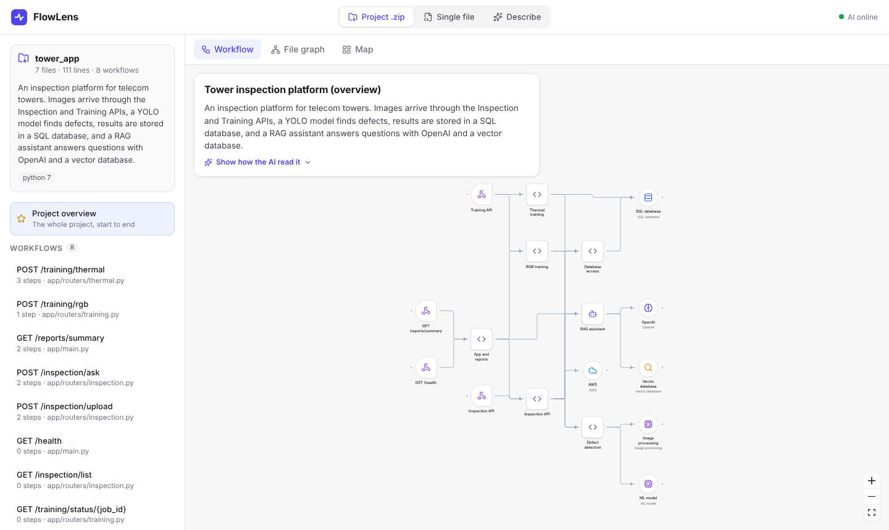
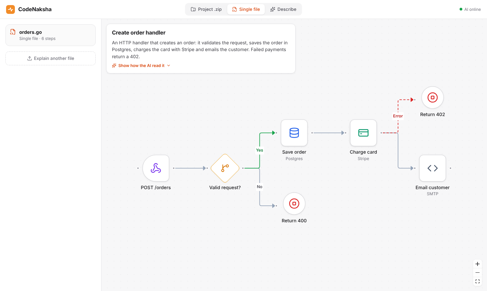
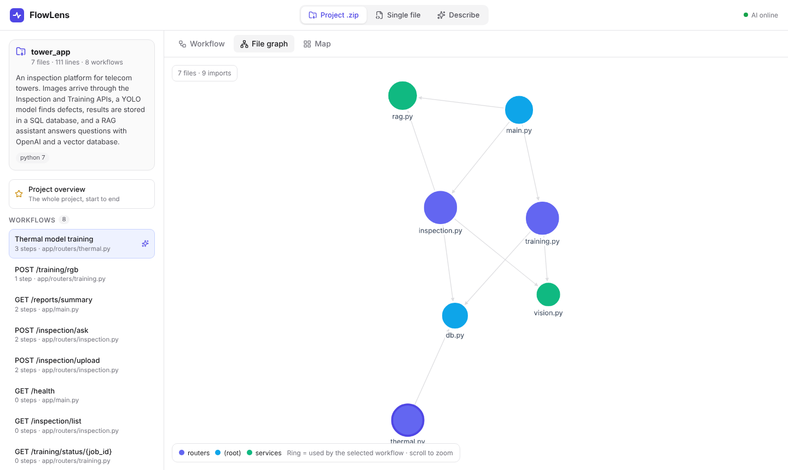
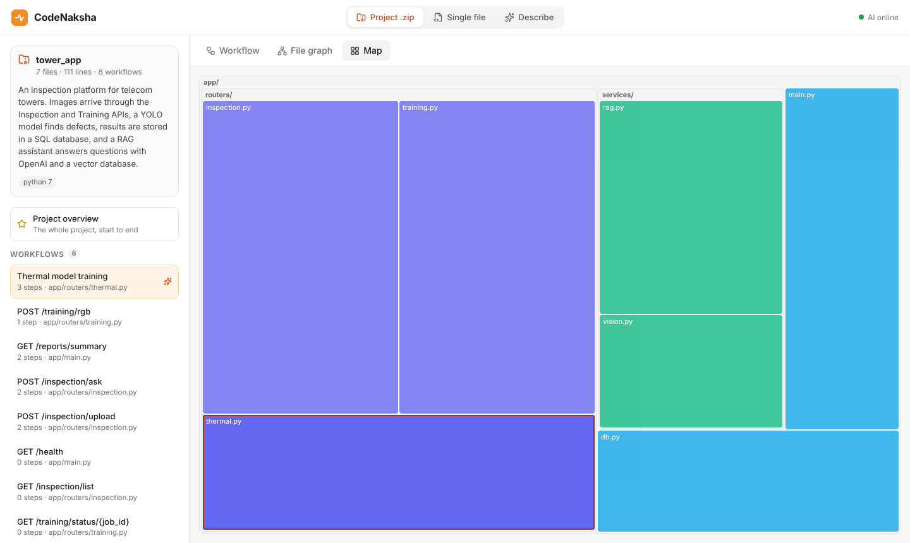

# CodeNaksha

**Understand any codebase as a workflow.** Pick one of three modes at the top of the screen:

| Mode | You give | You get |
|---|---|---|
| **Project .zip** | a zip of your repository | the **full project workflow** with an AI summary, every API route / job / CLI traced step by step, a file graph and a map |
| **Single file** | one source file in **any language** | a workflow of that file with a short AI summary, each step linked to its line |
| **Describe** | a process in plain words | a workflow or flowchart |

For a project zip you get:

- **Project overview** (opens first): entry points grouped by feature ("Training API", "Inspection API", "Command line", "Start main.tsx") → your code → the services it uses (databases, AI models, vector stores, cloud). Shown seconds after the zip is read; the AI summary fills in while you look.
- **Workflows**: each entry point traced step by step, n8n-style, including AI agents and their tools. Click **Explain with AI** on any workflow for plain-English step names.
- **File graph**: every file and what it imports. Click a file to see its role, functions and connections.
- **Map**: a bird's-eye treemap of the whole repository, with folders as regions and files sized by lines of code.

Everything runs on your own machine with an open model (**Qwen3-Coder-30B-A3B**, Apache 2.0) served by **llama.cpp**. It works on an NVIDIA GPU with as little as 8–12 GB of VRAM, or on the CPU alone. CodeNaksha itself is Apache 2.0.



| One workflow, explained by AI | Single file (any language) |
|---|---|
|  |  |

| File graph | Map |
|---|---|
|  |  |

*Screenshots use a small sample project.*

---

## How it works

Most of the work is plain, deterministic code. The AI model only adds explanations, so a mid-range GPU (or even a CPU) is enough.

```
 .zip ─► safe unzip ─► tree-sitter parse ─► resolve imports ─► file graph + map
                                    │
                                    ├─► detect triggers (routes, jobs, CLIs, events)
                                    ├─► detect services (Postgres, Slack, OpenAI, ...)
                                    └─► walk call graph ─► prune ─► workflow skeleton
                                                                      │
                     Qwen3-Coder (optional) ◄── compact JSON ─────────┘
                       • project overview: title, summary, role of each part (1 request)
                       • one-line summaries of the 40 most-used files (batched, cached)
                       • per-workflow step names: only when you click "Explain with AI"
                       • JSON-schema constrained, validated in code
```

**Fast by design:** the code analysis finishes in seconds and is shown right away. Up front the model only writes the overview and a few batched file summaries, so a typical project is done in about a minute or two. Individual workflows are explained on demand, and every answer is cached: uploading the same code again is instant.

**Single file, any language:** the file is sent to the model with line numbers (Python, JS and TS files also get a function outline from the parser). The model returns a checked workflow plus a summary.

**Getting "deep thinking" from a model without a thinking mode:** every response schema starts with an `analysis` field, so the model reasons first and answers second. Graph problems are found by a validator in plain code (`backend/app/llm/validate.py`), and only those errors go back to the model.

**Without a model**, CodeNaksha still works: workflows use names taken from the code (`lookup_order` becomes "Lookup order").

### What a workflow shows

CodeNaksha reads each function's **control flow**, not just its calls:

| In the code | In the workflow |
|---|---|
| a function that uses a service (DB, Slack, Stripe, ...) | a step with the service's icon |
| an LLM call with helper functions | an **agent** with its **tools** underneath |
| `if` / `elif` / `else`, `match`, `switch` | a **decision** with Yes / No (or case) paths |
| `try` / `except`, `try` / `catch` | a red **error** path from the step that can fail |
| `for`, `while`, `items.forEach(...)` | a **loop** with a back-edge |
| `raise`, `throw`, early `return` | an **end** node ("Error 404", "Return early") |
| `asyncio.gather`, `Promise.all` | steps that run **in parallel** |

The default **simple view** hides decisions, loops and exits so you see just the
steps; switch on **Show conditions & loops** for the full logic. Repeated calls
in a row are merged into one step ("Database session (x4)").

Helper functions that don't touch a service are expanded in place, so their
steps and branches stay visible. Branches that lead nowhere interesting are
hidden, and branching is drawn for the trigger and the functions it calls
directly, which keeps big codebases readable.

### Supported languages

| Language | File graph & map | Workflows |
|---|---|---|
| Python | ✅ | ✅ FastAPI (incl. `APIRouter(prefix=...)`), Flask, Celery, Click/Typer, AWS Lambda, `__main__` |
| JavaScript / TypeScript | ✅ | ✅ Express-style routers, NestJS, cron, Bull/BullMQ, Lambda |
| Go, Java, Ruby, PHP, Rust, C/C++, ... | Listed in the map | Use **Single file** mode (AI-based, any language) |

---

## Hardware

Qwen3-Coder-30B-A3B is a **Mixture-of-Experts** model: 30B parameters in total, but only ~3B are active per token. llama.cpp can keep the expert weights in system RAM and run the rest on the GPU (`--n-cpu-moe`), so the model doesn't need to fit in VRAM.

| Setup | Minimum | Notes |
|---|---|---|
| **GPU + CPU** (recommended) | NVIDIA GPU with 8 GB+ VRAM, **32 GB RAM** | Tested target: RTX 5070 12 GB |
| **CPU only** | **32 GB RAM**, modern 8-core CPU | Slower, but works; fast RAM helps most |
| **No model** | Any machine | Code analysis only |

The default model file (`Q4_K_M` GGUF) is about **18.6 GB** on disk.

---

## Quick start (Docker)

```bash
git clone https://github.com/<you>/CodeNaksha.git
cd CodeNaksha
cp .env.example .env          # then set LLM_API_KEY to a long random string
                              # (the release zip already contains a ready .env)
```

Pick one:

```bash
# A) NVIDIA GPU + system RAM (e.g. RTX 5070 12 GB)
docker compose --profile gpu up -d --build

# B) CPU only. First set LLM_BASE_URL=http://llm-cpu:8080/v1 in .env
docker compose --profile cpu up -d --build

# C) No AI model: code analysis only
docker compose up -d --build
```

Open **http://localhost:8080**.

The first start downloads the model (~18.6 GB). To follow it:

```bash
docker compose logs -f llm-gpu      # or llm-cpu
```

It's ready when the log shows the server listening on port 8080. The **AI model** dot in the top-right corner of the UI then turns green.

### GPU setup (once, profile `gpu` only)

Docker needs the **NVIDIA Container Toolkit** to use your GPU. Without it you get `could not select device driver "nvidia"`.

```bash
nvidia-smi                                   # driver must work on the machine first

curl -fsSL https://nvidia.github.io/libnvidia-container/gpgkey \
  | sudo gpg --dearmor -o /usr/share/keyrings/nvidia-container-toolkit-keyring.gpg
curl -s -L https://nvidia.github.io/libnvidia-container/stable/deb/nvidia-container-toolkit.list \
  | sed 's#deb https://#deb [signed-by=/usr/share/keyrings/nvidia-container-toolkit-keyring.gpg] https://#g' \
  | sudo tee /etc/apt/sources.list.d/nvidia-container-toolkit.list
sudo apt-get update && sudo apt-get install -y nvidia-container-toolkit
sudo nvidia-ctk runtime configure --runtime=docker
sudo systemctl restart docker

docker run --rm --gpus all ubuntu nvidia-smi # must list your GPU
```

Use **Docker Engine** (`docker context show` prints `default`). Docker Desktop on Linux and the snap package can't pass a GPU to containers.

### Tuning for your GPU

All of these settings live in `.env`. After a change, run `docker compose --profile gpu up -d` again.

| Setting | Default | What it does |
|---|---|---|
| `LLM_CPU_MOE` | `30` | Number of layers (of 48) whose experts stay in system RAM. **Lower = faster, more VRAM.** |
| `LLM_CTX_SIZE` | `32768` | Total context, shared by all parallel slots |
| `LLM_PARALLEL` | `2` | Requests the model handles at once |
| `LLM_GGUF_REPO` | `unsloth/Qwen3-Coder-30B-A3B-Instruct-GGUF:Q4_K_M` | Model file. Use `:Q3_K_M` if RAM is tight. |
| `LLAMA_IMAGE_TAG` | `server-cuda` | Use `server-cuda13` with NVIDIA driver 590+ for native RTX 50-series kernels |

Starting values for `LLM_CPU_MOE`:

| VRAM | Start at |
|---|---|
| 8 GB | 40 |
| 12 GB | 30 |
| 16 GB | 20 |
| 24 GB | 0–8 |

Watch `nvidia-smi` while it runs:
- If VRAM use stays below ~80%, lower the value for more speed.
- If the model crashes with out-of-memory, raise it.
- Leave about 1 GB free for your desktop.

---

## Local development (backend and frontend outside Docker)

In this mode the **model runs in Docker** and the backend and frontend run directly on your machine.

**1. Start only the model.** It's published on `127.0.0.1:8081`, reachable from this machine only:

```bash
docker compose --profile gpu up -d llm-gpu
```

**2. Check `backend/.env`.** The backend reads `.env` from the folder you start it in, *not* the project root. Docker service names like `llm-gpu` don't work outside Docker, so it uses `localhost`:

```env
LLM_ENABLED=true
LLM_BASE_URL=http://localhost:8081/v1
LLM_MODEL=CodeNaksha-llm
LLM_API_KEY=<same value as LLM_API_KEY in the root .env>
LLM_TIMEOUT_S=300
LLM_CONCURRENCY=2
MAX_CONCURRENT_JOBS=1
DATA_DIR=./data
```

**3. Run the backend** (Python 3.11+):

```bash
cd backend
python -m venv .venv && source .venv/bin/activate
pip install -r requirements-dev.txt
uvicorn app.main:app --reload --reload-dir app   # http://localhost:8000, docs at /docs
pytest -q && ruff check .
```

**4. Run the frontend** (Node 20+), in another terminal:

```bash
cd frontend
npm install
npm run dev                          # http://localhost:5173 (proxies /api to :8000)
```

Run **either** the Docker `api` container **or** `uvicorn`, not both.

Keep `--reload-dir app`: without it, uvicorn may restart while a job runs and the UI shows "Job not found or expired".

---

## Troubleshooting

### "AI model offline"

Open `http://localhost:8000/api/health`:

```json
{ "status": "ok", "llm_enabled": true, "llm_available": false }
```

`llm_available: false` means the backend can't get an HTTP 200 from `<LLM_BASE_URL>/models`. Check these in order:

**1. Which address is the backend using?** Run this from the folder you start the backend in:

```bash
python -c "from app.config import get_settings as g; s=g(); print(s.llm_base_url)"
```

| Output | Fix |
|---|---|
| `http://localhost:8001/v1` | No `.env` found, so defaults are used. Create `backend/.env`. |
| `http://llm-gpu:8080/v1` (outside Docker) | Use `http://localhost:8081/v1` |

**2. Is the model running?**

```bash
docker compose ps
docker compose logs --tail 40 llm-gpu
```

**3. Can you reach it?**

```bash
curl -i http://localhost:8081/v1/models -H "Authorization: Bearer <LLM_API_KEY>"
```

| Result | Fix |
|---|---|
| Connection refused | The model isn't running or the port isn't published (see step 1 of local development) |
| `401` | `LLM_API_KEY` differs between the backend and the model |
| `503` / loading | Still loading; wait |
| `200` | Restart uvicorn. `--reload` doesn't pick up `.env` changes. |

After changing `LLM_API_KEY` in the root `.env`, recreate the model container so it uses the new key: `docker compose --profile gpu up -d llm-gpu`.

### Other problems

| Problem | Fix |
|---|---|
| `could not select device driver "nvidia"` | Install the NVIDIA Container Toolkit (see GPU setup) |
| Model crashes with out-of-memory | Raise `LLM_CPU_MOE`, or lower `LLM_CTX_SIZE` to `16384` |
| Machine freezes / swaps | Not enough RAM: use `LLM_GGUF_REPO=...:Q3_K_M` |
| `Conflict. The container name ... is already in use` | `docker rm -f <name>`, then start again |
| "Job not found or expired" | Start uvicorn with `--reload-dir app` (see local development) |
| Overview/workflows appear, AI names never do | The model is slow or busy: check `docker compose logs -f llm-gpu`; lower `MAX_FILE_SUMMARIES` |
| Single file: "This looks like a binary file" | Upload a text source file (max `SINGLE_FILE_MAX_KB`) |
| "No entry points were found" | The project has no Python/JS/TS entry points (see Supported languages), or the zip doesn't contain the code. Check it with `unzip -l project.zip`. |
| Files missing from the analysis | Folders like `node_modules/`, `vendor/`, `dist/`, `build/` and files over `MAX_FILE_KB` are skipped |

---

## Hosting it publicly

1. In the Cloudflare dashboard, go to **Zero Trust → Networks → Tunnels**. Create a tunnel and add a public hostname pointing to `http://web:80`.
2. In `.env`, set `CLOUDFLARE_TUNNEL_TOKEN` and `TRUST_PROXY_HEADERS=true`.
3. Start everything with `docker compose --profile gpu --profile tunnel up -d`.

You don't need to open any ports, and your home IP stays hidden. Never publish the model port (`8081`) itself.

**Built-in protection:**
- Uploaded code is parsed statically and never executed.
- Zip-slip paths, symlinks and oversized files are rejected.
- Upload size and file count are capped.
- Each IP has an hourly rate limit.
- Only `MAX_CONCURRENT_JOBS` jobs use the model at once; the rest queue.
- Uploads are deleted right after analysis, and results expire after `JOB_TTL_MINUTES`.

**Before a big public launch**, also add sign-in (e.g. GitHub OAuth) and per-user quotas. See the roadmap below.

---

## Configuration

All settings are environment variables (see `.env.example`).

| Variable | Default | Description |
|---|---|---|
| `LLM_ENABLED` | `true` | Turn AI enrichment on or off |
| `LLM_BASE_URL` | `http://localhost:8001/v1` | Any OpenAI-compatible server. Docker: `http://llm-gpu:8080/v1` / `http://llm-cpu:8080/v1`. Local dev: `http://localhost:8081/v1` |
| `LLM_MODEL` | `CodeNaksha-llm` | Model name sent to the server |
| `LLM_API_KEY` | `not-needed` | Shared secret between the backend and llama.cpp |
| `LLM_TIMEOUT_S` | `180` | Use `300` or more with CPU offload |
| `LLM_TEMPERATURE` | `0.3` | Low values give steadier JSON |
| `TRAINING_LOG` | `false` | Save model requests + answers as training data (see `training/`) |
| `LLM_CONCURRENCY` | `2` | Model requests sent at once. Match `LLM_PARALLEL` on the model server. |
| `MAX_FILE_SUMMARIES` | `40` | Files summarized up front (most-used first). Lower = faster uploads. |
| `SINGLE_FILE_MAX_KB` | `300` | Size limit in Single file mode |
| `FILE_MAX_CHARS` | `24000` | Code sent to the model in Single file mode (about 7k tokens) |
| `MAX_UPLOAD_MB` | `50` | Maximum zip size |
| `MAX_FILES` | `5000` | Maximum source files per zip |
| `MAX_FILE_KB` | `512` | Larger files are skipped |
| `MAX_CONCURRENT_JOBS` | `2` | Jobs processed at once. Use `1` on a single mid-range GPU. |
| `RATE_LIMIT_PER_HOUR` | `20` | Uploads/prompts per IP per hour (`0` disables) |
| `TRUST_PROXY_HEADERS` | `false` | Read the client IP from Cloudflare / proxy headers |
| `WEB_PORT` | `8080` | Port for the web UI |
| `LLM_PORT` | `8081` | Local-only port for the model server |

---

## API

| Method | Path | Description |
|---|---|---|
| `GET` | `/api/health` | Server and model status |
| `POST` | `/api/analyze` | Multipart upload of a `.zip`, returns `{job_id}` |
| `POST` | `/api/prompt` | `{"prompt": "..."}`, returns `{job_id}` |
| `POST` | `/api/file` | Multipart upload of one source file (any language), returns `{job_id}` |
| `POST` | `/api/explain` | `{"graph": {...}, "file_summaries": {...}}`: AI names for one workflow, returns `{job_id}` |
| `GET` | `/api/jobs/{id}` | Status and result |
| `GET` | `/api/jobs/{id}/events` | Live progress (Server-Sent Events) |

Interactive docs are at `http://localhost:8000/docs` when the backend runs directly.

---

## Project structure

```
backend/app/
  main.py              API routes, uploads, rate limiting, SSE
  jobs.py              background jobs + progress events
  schema.py            the one graph schema shared by every part
  pipeline/
    ingest.py          safe zip extraction
    parser.py          tree-sitter: imports, functions, calls, decorators
    resolver.py        import → repo file / external package
    codeindex.py       cross-file index and call resolution
    triggers.py        entry point detection
    integrations.yaml  package → service catalog (add yours!)
    workflows.py       call graph → n8n-style workflow (repeats merged)
    overview.py        whole-project overview: entries → code → services
    analyzer.py        runs the pipeline
  llm/
    client.py          OpenAI-compatible client, JSON-schema output
    prompts.py         prompts + schemas (with the `analysis` field)
    enrich.py          overview, summaries, step names, single file, prompt → graph
    validate.py        graph checks + auto repair
    cache.py           SQLite cache keyed by content hash
frontend/src/
  views/               WorkflowView, FileGraphView, MapView
  components/          StartPanel (upload screens), Sidebar (workflow list), DetailsPanel
  lib/simplify.ts      simple view: hides decisions/loops, merges repeats
  store.ts             app state (Zustand)
  lib/layout.ts        dagre layout with agent tools underneath
```

## Extending

- **New service:** add one line to `backend/app/pipeline/integrations.yaml`.
- **New framework trigger:** add a pattern in `backend/app/pipeline/triggers.py`.
- **New language:** add a walker in `parser.py` (tree-sitter grammars for 100+ languages are already available) and resolution rules in `resolver.py`.

## Training your own model

`training/` turns n8n and Mermaid datasets plus your own reviewed CodeNaksha
runs into training data in CodeNaksha's schema. It fine-tunes a small model
(Qwen3-4B, Apache 2.0) on a 12 GB GPU and measures the result before and
after. See [training/README.md](training/README.md).

## Roadmap

- [ ] Ruby (Rails routes, Sidekiq), Go, Java and PHP workflows
- [ ] Sign-in (GitHub OAuth) and per-user quotas
- [ ] Valkey + RQ job queue for multi-server deployments
- [ ] Export to n8n workflow JSON and Mermaid
- [ ] Detail levels and double-click drill-down into a step
- [ ] Release a fine-tuned CodeNaksha-4B model on Hugging Face

## License

CodeNaksha is licensed under the [Apache License 2.0](LICENSE).

The AI model is **not** bundled. llama.cpp (MIT) downloads it from Hugging Face under its own license; Qwen3-Coder-30B-A3B-Instruct is Apache 2.0. See [NOTICE](NOTICE) and [THIRD_PARTY_LICENSES.md](THIRD_PARTY_LICENSES.md).
